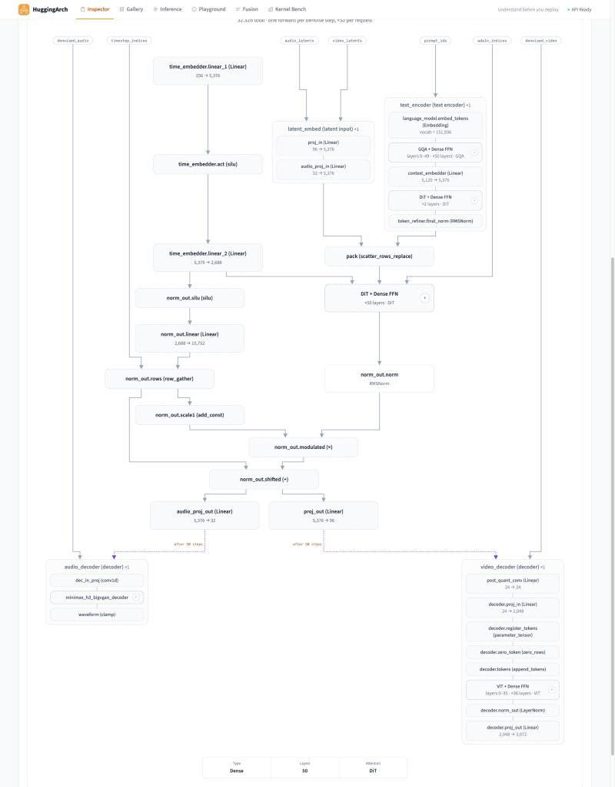

# Diffusion pipelines (MiniMax-H3)

HuggingArch describes decoder-only (multimodal) LLMs. This note says how a
diffusers pipeline — one repo, several components, a transformer run once per
denoise step — is read and specified, using MiniMax-H3 text-to-video-and-audio
(revision `42ed227`) as the worked case. It is a local extension, not upstream
design.

The spec and its snapshot live in an overlay, `overlays/minimax_h3/`
(`models/`, `snapshots/`), not in the shared corpus: a model admitted to the
corpus owes every pin its keys, and H3's admission is blocked (below). The
components, ops and schema additions are in the shared tree.

```bash
.venv/bin/python -m backend.arch.validate MiniMaxAI/MiniMax-H3 --overlay-dir overlays/minimax_h3
HA_SPEC_OVERLAY_DIR=$PWD/overlays/minimax_h3 .venv/bin/python -m backend.api --host 127.0.0.1 --port 8057
# then http://127.0.0.1:8057/inspector.html#model=MiniMaxAI%2FMiniMax-H3
```



## How the repo is read

`backend/hf/pipeline.py` reads a repo whose root holds `model_index.json` and
no root checkpoint as one model:

* **config** — the index's `_` facts, each component's own config file under
  the component's name (`config.transformer.hidden_size`,
  `config.text_encoder.text_config.num_hidden_layers`), and every component's
  `[library, class]` under `_components`;
* **checkpoint** — every weighted component's safetensors, each tensor named
  under its folder (`transformer.proj_in.weight`,
  `text_encoder.model.language_model.embed_tokens.weight`). A spec addresses a
  component the way it addresses `model.`: `checkpoint: {root: transformer}`.

`metadata.fetch_config` / `read_header_hf`, the snapshot writer and the
forward-source fetch (`_try_pipeline_sources`: the transformers module per
component `model_type`, the diffusers module that defines each component class,
read as text) all go through it. The task gate admits such a repo.

## How H3 maps onto the spec

| H3 stage | spec | why |
|---|---|---|
| DiT (50 blocks, AdaLN, joint attention) | the **backbone**; its step is one denoise forward, `s_ctx` the packed rows (text + video + audio) | the one stack whose attention is over the step's sequence |
| Qwen3-VL text encoder (layers 0-49) + `context_embedder` + `token_refiner` | encoder group `text_encoder` (`aux_kind: text`) reading `prompt_ids: {kind: text}` | runs once per request over its own rows |
| `proj_in` (1×2×2 patches), `audio_proj_in` | encoder group `latent_embed` (`aux_kind: latent`) | its rows are request-sized, which the LM step cannot see |
| video ViT decoder, tiled | encoder group `video_decoder` (`aux_kind: decoder`) reading `denoised_video` | its own rows (tiles), once per request |
| BigVGAN audio decoder | encoder group `audio_decoder` (`aux_kind: decoder`) reading `denoised_audio` | once per stereo channel |

The packed sequence is `zeros` filled by one `scatter_rows_replace` of the text,
video and audio rows (`prompt_slots` with each input as its domain), so the
handoffs are the existing encoder→LM ones. The two per-row ids the forward
reads — `adaln_indices` and `timestep_indices` — are the step's `kind: tokens`
inputs.

## What the spec language gained

| addition | where | what it says |
|---|---|---|
| `model_inputs.<x>.kind: text` | `schema/model.py` | a prompt an encoder embeds (`[items, length]` ids) |
| `aux_kind: text \| latent \| decoder` | `schema/model.py`, badges | a pipeline's stages around its transformer; a `decoder` group is a sink: it defines no prompt positions, and inputs only decoders read need no defining edge |
| `denoise_loop: {steps, latents: [{start, update, end}], source_anchor}` | `schema/spec.py` | the step runs `steps` times per request; the scheduler applies head `update` to latent `start`; decoders read `end`. The view draws `update → reader of end` ("after N steps") |
| `checkpoint_unread: [{module, layers?, kind, reason, source_anchor}]` | `schema/model.py`, `arch/checkpoint_unread.py` | modules the file stores and this path never runs; the validator and the analyzer compare the spec with the rest of the file and report each entry |
| causal attention in an encoder | `eval/evaluator.py` | an encoder's causal score prices the lower triangle of its own rows |
| a mask stated by the frame | `validate/_attention_masks.py` | `is_causal` bound at the block assignment counts as stated (a library LM attention inside an encoder) |
| encoder rotation axes by input kind | `validate/_rotary_positions.py` | a video encoder may rotate by (t, h, w) |
| one head-count rule per stack | `layout/attention_plan.py` | a stack with two query-head counts runs replicated unless the degree divides both |
| no-cache attention family `DiT` | `cache_families.yaml`, `_type_contracts.py` | a backbone attention of kind `none` needs no `cache.entries` |
| an output head only with a token LM | `document.py` | the input embedding may sit in an encoder group; then the backbone needs no logits head |

New primitives (`ops_registry.py`, "Diffusion pipelines"; DimMaps in
`axis_propagation.py`; layout laws in `layout/pipeline.py`): `zeros`,
`zero_rows`, `sinusoidal_embedding`, `view_rows`, `row_gather`, `rope_3d`,
`conv_transpose1d`, `conv1d_weight_norm`, `conv_transpose1d_weight_norm`,
`filter_buffer`, `snake_beta`, `append_tokens`, `tile_video`, `untile_video`.
New components: `minimax_h3_dit_block`, `minimax_h3_attention`,
`minimax_h3_refiner_block`, `minimax_h3_vae_block`,
`minimax_h3_vae_attention`, `minimax_h3_bigvgan_decoder`,
`bigvgan_amp_block`, `diffusers_swiglu_ff`, `partial_rope_3d`,
`identity_rope`.

## Checker result

`python -m backend.arch.validate MiniMaxAI/MiniMax-H3 --overlay-dir
overlays/minimax_h3` is valid: storage bytes
126,549,970,116 spec = file (read part), every tensor matched. Per stage:

| stage | parameters |
|---|---:|
| DiT (`transformer.*`) | 33,122,992,896 |
| of which AdaLN projections | 13,010,457,600 |
| text encoder layers 0-49 | 24,379,916,800 |
| text encoder embedding | 777,912,320 |
| video VAE decoder (incl. `post_quant_conv`) | 2,423,531,096 |
| audio decoder (incl. 3,048 filter-buffer values) | 64,939,353 |

Declared unread: text layers 50-63 (6,826,376,704), final norm, LM head, the
vision tower, both autoencoders' encoders, `audio_vae.logs_proj`, and
`transformer_ref` (Ref2VA's transformer, 33,122,992,896).

## Corpus admission (`tools.corpus_admit`, dry run): needs review

Every measurement and corpus check passes for H3 (`G0`, `G1`, `G2` clean); the
run's status is `needs_review`, waiting only on decision D1.

| gate | what it raised | the fix |
|---|---|---|
| P2 SOL surface | the capacity model needs a KV cache to budget; the DiT keeps none | a model whose attentions declare no cache (the reader has no entry) has all-zero budget terms, no token limit, and a batch divided by the activation budget (`capacity_ceilings`); a declared cache that holds nothing is still refused |
| P5 (8-GPU deployment) | `pack`: the `zeros` buffer is laid out replicated on the batch axis while the rows it is filled with follow the data-parallel request owner | `zeros` is laid out as the step's own inputs arrive (`layout/pipeline.step_rows`); the other built tensors keep the batch axis on the request owner |
| P11 | a measurement keyed on model inputs does not know `denoised_video` (read only by a decoder) | the reference media read the side factor from `ModelInput.least`, which any processor cut sets (`patchify`, `tile_video`) |
| C5 checkpoint invariants | compares the spec's weights with the whole header, without the `checkpoint_unread` split the validator and analyzer apply | `Reconciliation.of` applies the same split |
| C7 overview connected | `time_embedder.linear_1` has no incoming edge: its input `time_proj` is a source op the overview draws no card for | a card whose reads are all operands is where the graph starts; the operand is drawn as its input |

D1 is a person's: for every node the model file itself defines, how a framework
splits it over TP. The sources `corpus_admit` can stage decide nothing here
(diffusers' H3 modules never reach `torch.distributed`), so each stack's entry
has to be written by hand in `tests/golden/pins/tp_split_decisions.json`. The
keyed pins (P1, P2, P3, P7, P11) are withheld until then, so H3 stays in the
overlay: a model in the corpus without its pins turns the corpus tests red.

## FastH3 V2 NVFP4 Consumer

`overlays/fasth3_v2_nvfp4/` holds FastVideo's 8-step FastH3 for one Blackwell
GPU (`FastVideo/FastVideo-FastH3-8-Step-V2-NVFP4-Consumer`, revision `9d0d0d3`),
read as FastVideo loads it at commit `ce970eb`. It is a second overlay beside
the base H3; both stay out of the shared corpus.

```bash
.venv/bin/python -m backend.arch.validate FastVideo/FastVideo-FastH3-8-Step-V2-NVFP4-Consumer --overlay-dir overlays/fasth3_v2_nvfp4
HA_SPEC_OVERLAY_DIR=$PWD/overlays/fasth3_v2_nvfp4 .venv/bin/python -m backend.api --host 127.0.0.1 --port 8058
```

The checker is valid: weights 54,088,201,236 bytes and scales 2,851,138,684
bytes, spec = file (the read part), every tensor matched. Bytes per stage,
summed from the safetensors headers:

| stage | bytes | format |
|---|---:|---|
| DiT (`transformer/`, shards + `nvfp4_weights.safetensors`) | 39,632,637,892 | NVFP4 attention, FFN and gates; the rest BF16 |
| text encoder (layers 0-49 and embedding) | 15,270,283,640 | NVFP4 linears, BF16 norms and embedding |
| video decoder (26 layers of 32×64) | 1,776,660,976 | INT8 linears, F32 the rest, F16 `post_quant_conv` |
| audio decoder | 259,757,412 | F32 |

Declared unread: the text encoder's final norm and vision tower, both VAEs'
encoders, the audio posterior heads, and the dense F16 video decoder the INT8
export overwrites.

### What the repo needed from the reader and the checker

| addition | where | what it says |
|---|---|---|
| sidecar safetensors | `hf/pipeline.py` | a file in a component's folder beside the checkpoint its library loads is read too: new names join the component, a file restating a name keeps its own space under its stem |
| three quant schemes | `quant_schemes/` | `nvfp4-packed` (text encoder), `nvfp4-fastvideo-export` (`<module>::_nvfp4_weight`), `int8-convrot` (`.weight`, per-channel scale, JSON marker) |
| sidecars the config names no scheme for | `checkpoint_unread.undeclared_sidecars` | a pipeline's composed config names no scheme, so the spec's declared scales are filed as scales when the header is summed |
| `global_scale`, `marker` sibling kinds | `quant_schemes` | one scale per tensor; a stored format tag |
| `checkpoint_unread` on a bare parameter | `schema/model.py` | an entry may name one tensor, not only a module |
| `attention_refiner`, `ffn_refiner` roles | `roles.yaml` | H3's token refiner stays BF16 beside a quantised text encoder in one stage |

### Sparse attention

`fasth3_vsa_attention` follows `vsa_fp4_attention`: pool Q and K over 64-token
tiles, score every tile pair, keep each video query tile's non-video keys and
its top 20% of video keys, run the attention on the kept tiles
(`block_sparse_attention`, one kernel), and add the gated tile-level
compression back. It is priced on `s_pairs_kept`, the (query row, key row)
pairs the selection keeps: 0.228 of the dense matrix at 1344x768, 124 frames.
The DiT's sparse attention is 9.5 TFLOP per block there, against 41.7 dense.

### What the overlay does not represent

* **The kernel's block granularity.** FastVideo computes on 128x128 blocks with
  per-quadrant masks, so at 0.8 sparsity it touches more than it keeps (0.434
  of the matrix against 0.222 selected, at 243 frames); warp-level skipping wins
  part of that back. The FLOPs here count kept pairs, not touched ones.
* **The clip is pinned.** `s_vsa_*` and the tile counts are the default view,
  with a 256-row prompt assumed. The kept pairs follow the packed rows the
  step binds; tile pooling and scoring do not.
* **Activation quantization and the ConvRot rotation.** FastVideo quantises
  each linear's activation to FP4, and rotates the VAE's by a 256-point
  Hadamard before INT8. Those passes have no node; the linears are priced as
  plain matmuls. The FP8 prefix path and two-level P are not modelled.
* **The optional AdaLN table** (`transformer/adaln_tables.pt`, read only when
  `FASTVIDEO_H3_ADALN_TABLE` is set). The spec runs the AdaLN projections.
* **Parallel layouts.** The tile ops are laid out whole, so only a single rank
  is meaningful, which is how the checkpoint is meant to run.
* The snapshot's forward source is the diffusers and transformers modules the
  index names, not FastVideo's; the `source_anchor`s cite FastVideo's files.

## Known gaps

* `proj_in`, `audio_proj_in`, `context_embedder` and `token_refiner` run inside
  every DiT forward in diffusers; here they are walked once per request.
* The text encoder rotates by 1-D RoPE: exact for a text-only prompt, where
  Qwen3-VL's three M-RoPE position streams coincide.
* `denoised_video` / `denoised_audio` are inputs of their own: a model input is
  read by one encoder stack, and nothing in the graph turns the noise into them.
* The `/analyze` dashboard still prices a "decode" step for the DiT; only the
  prefill-shaped step (one denoise forward) means anything.
* The step count is a spec dim (`n_denoise_steps: 50`), not a workload axis.
* The decoders' overlap cross-fade is counted as zero FLOPs.
